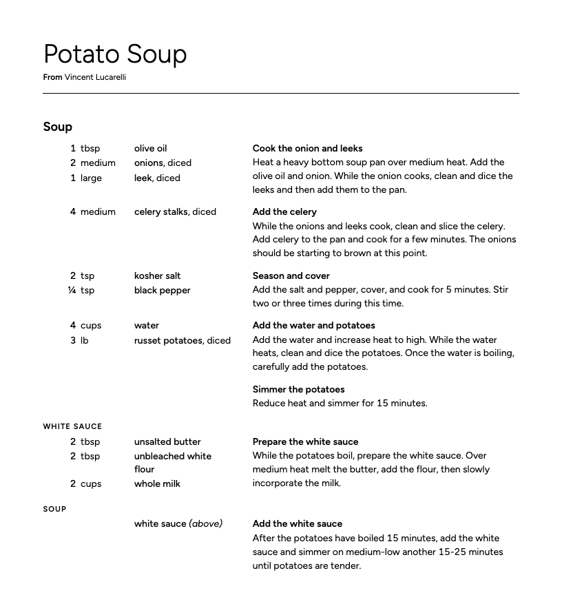

# Etna

Etna is a method to write recipes in plain Markdown that both people and programs can
understand. You read it as a recipe; Etna reads it as structured data.

Ingredients live alongside the steps where they are used, so a single recipe can become
a printable recipe card, a flow chart of how the dish comes together, or a shopping
list.

Etna was built with the help of AI, and an AI assistant can help you put a new recipe
into Etna's format if you want one. Etna itself runs without any AI service: the card,
the chart, and the list come from the structure of the file alone.

This repository brings it all together: the recipe format, a cookbook of examples and
lessons, and the TypeScript tools to check, format, print, chart, and serve recipes.

## Take a look — nothing to install

The [Etna viewer](https://caldera-kitchen.github.io/etna/) is a good place to start.
Browse the example recipes that come with Etna and see them as Markdown source, a
recipe card, and a flow chart. Everything runs right in your browser.

## One recipe, several ways to see it

Here is an excerpt from [`cookbook/potato-soup/recipe.md`](cookbook/potato-soup/recipe.md),
lesson 2 in the [cookbook](cookbook/README.md):

```markdown
# Potato Soup

## Soup

### Cook the onion and leeks

- 1 tbsp olive oil
- 2 medium onions, diced
- 1 large leek, diced

Heat a heavy bottom soup pan over *medium heat*. Add the olive oil and onion. While the onion cooks, clean and dice the leeks and then add them to the pan.

…

### White sauce

#### Prepare the white sauce

- 2 tbsp unsalted butter
- 2 tbsp unbleached white flour
- 2 cups whole milk

While the potatoes boil, prepare the white sauce. Over *medium heat* melt the butter, add the flour, then slowly incorporate the milk.

### Add the white sauce

- [white sauce](#white-sauce)

After the potatoes have boiled 15 minutes, add the white sauce and simmer on *medium-low* another *15-25 minutes* until potatoes are tender.
```

The idea is simple: each heading at the bottom of the outline is a step. Its
ingredient list tells you what goes in, and the paragraph tells you what to do.

Headings with steps beneath them are components — parts of the dish that come
together to make the whole. Here, the soup contains a white sauce of its own.
The link `- [white sauce](#white-sauce)` brings that component into the soup at the
right moment.

From this one file, Etna can make several things:

**A recipe card** (`etna card`) puts each step's ingredients beside its directions,
grouped under the part of the dish they belong to. Seven card styles are included.



**A flow chart** (`etna dag`, SVG or PDF) shows how the dish comes together.
Ingredients flow into steps and steps flow into follow-on steps. Here, the white
sauce is prepared separately before joining the soup.


**A shopping list** (`etna list`) gathers and adds up the ingredients for one
recipe or a whole collection.

The excerpt above is in Etna's structured form, with ingredients under their steps.
You are not required to use it for every recipe: Etna also supports the traditional
form, one ingredient list followed by numbered directions. Lesson 1 is this same
potato soup written in the traditional form. Only flow charts require the structured
form.

## Getting started

You need [Git](https://git-scm.com) and [Node.js](https://nodejs.org) 24 or newer.
Etna runs its TypeScript source directly through Node, so there is no build step.
Open source fonts are included in the repository.

```bash
git clone https://github.com/caldera-kitchen/etna.git
cd etna/tools
npm ci
alias etna="node $PWD/bin/etna.js"
cd ..
```

The alias makes `etna` available for the current shell session.
If you'd rather install it permanently, use `npm link` instead.

Try it with the potato soup:

```bash
etna lint cookbook/potato-soup
etna fmt --check cookbook/potato-soup
etna card cookbook/potato-soup --out potato-soup.html
etna dag cookbook/potato-soup --out potato-soup.svg
etna serve cookbook
```

Here is what each command does:

1. `lint` checks your recipe against Etna's rules and exits with 1 if it finds an error.
2. `fmt --check` checks whether the recipe follows the standard source style. Run `etna fmt`
   to apply it.
3. `card` creates a printable recipe card. Open the HTML file in your browser and print it
   from there.
4. `dag` creates a flow chart. Add `--pdf` to get a PDF instead of an SVG.
5. `serve` starts the recipe viewer on your computer at `http://localhost:4173`. Press Ctrl+C
   to stop it.

For all the available options, run `etna <command> --help`.

## Where to next

There is plenty more to explore:

- **Learn by example:** [`cookbook/README.md`](cookbook/README.md) introduces the
  cookbook's recipes, from simple to more involved.
- **Bring a recipe into Etna:** [`docs/contributing-a-recipe.md`](docs/contributing-a-recipe.md)
  walks through turning a web page, scan, or recipe from memory into an Etna recipe.
- **Write better recipes:** [`docs/authoring-guide.md`](docs/authoring-guide.md) covers the
  details of writing and organizing them.
- **Start with a template:** [`templates/recipe-starter.md`](templates/recipe-starter.md) is
  ready to paste into a chat with an AI assistant.
- **Make your own collection:** Copy [`templates/collection/`](templates/collection/) into a
  new repository and make it yours.
- **Understand the format:** [`SPEC.md`](SPEC.md) describes the specification, and
  [`docs/decisions/`](docs/decisions/README.md) explains the thinking behind it.
- **Explore the tools:** [`tools/README.md`](tools/README.md) covers the command-line tools
  and how to host your own viewer.
- **Use an AI agent:** [`skill/SKILL.md`](skill/SKILL.md) is the procedure an agent follows
  to put your recipe into Etna's format. In a clone of Etna, ask your agent to read that file
  and follow it.

## Status

Etna 0.1 is working and ready to explore. The format and tools are still evolving,
so things may change on the way to 1.0.

## License

Etna uses a few licenses, depending on what's being shared:

- **Code and themes** (`tools/`, `themes/`): [MIT License](LICENSE).
- **Specification and documentation** (`SPEC.md`, `docs/`, `cookbook/README.md`,
  `registries/`, `rules.yaml`, `templates/`, `skill/`, `tests/`):
  [CC BY-SA 4.0](LICENSE-docs).
- **Recipes** under `cookbook/`: CC BY-SA 4.0, as specified in each recipe's frontmatter.

The fonts in `themes/.fonts/` come from Google Fonts and retain their own license,
the SIL Open Font License 1.1. See [`themes/.fonts/README.md`](themes/.fonts/README.md)
for details.

Copyright © 2026 Vincent Lucarelli.
