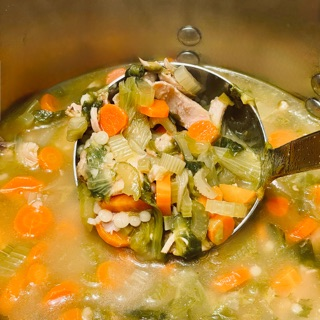

# Italian Wedding Soup

## Chicken Stock

### Break down the chicken

- 1 large Rotisserie Chicken, separate meat from bones; reserve meat for soup

Break down chicken and reserve meat for the finished soup.

### Simmer the stock

- 4 stalks Celery, cut into 2-inch chunks
- 4 large Carrots, cut into 1-inch pieces
- 2 large Yellow Onions, with skin, washed, quartered
- 4 cloves Garlic, with skin, washed, smashed
- 2 tsp Kosher Salt
- 10 Black peppercorns
- 12 cups Water

Place bones, skin, and all juices in large stock pot with all other ingredients. Bring to boil and then reduce heat to simmer for *2 hours*. Replenish water as needed.

### Strain the stock

Strain to separate stock from solids. Return stock to the pot and discard solids.

## Meatballs

### Mix and shape the meatballs

- 6 oz Ground beef — 80/20
- 1 oz Fresh bread crumbs
- 1 large Egg
- 1 fl oz Whole Milk
- 1 1/2 oz Romano Cheese
- 3/4 oz Yellow Onion, grated
- 1/2 oz Garlic, minced
- 1/2 tsp Dried Parsley
- 1/2 tsp Dried Basil

*Preheat oven to 350°F*. Mix all ingredients and form small meatballs, each the size of a small cherry tomato.

### Bake the meatballs

Bake on a cookie sheet for *about 30 minutes*, or until the meatballs are cooked through and well browned.

## Breads for Soup — optional

### Mix the batter

- 2 large Eggs, beaten until foamy
- 2 tbsp Romano Cheese
- 2 tsp Dried Parsley
- 4 tbsp Dried Italian Bread Crumbs
- 1 pinch Black Pepper

*Preheat oven to 350°F*. Combine all ingredients to form a soft batter.

### Spread and bake

Lightly grease a small (9x11 inch) cookie sheet and spread the batter in a thin, even layer. Bake *12-15 minutes* until golden brown. Cool and cut into cubes.

## Wedding Soup

### Simmer the vegetables

- [chicken stock](#chicken-stock)
- 1 1/2 tbsp Better Than Bouillon Chicken
- 3 large carrots, sliced
- 3 large celery stalks, sliced

To the strained stock, add bouillon, carrots, and celery. Bring to a boil and simmer *15 minutes*.

### Add escarole, chicken and meatballs

- 8 oz escarole
- 8 oz [chicken](#break-down-the-chicken), reserved from stock
- [meatballs](#meatballs)

Add escarole, chicken meat, and meatballs. Continue cooking for *15 minutes*.

### Add the pastina

- 3 oz pastina, orzo, stars, or acini di pepe

Add pastina and cook a final *15 minutes*.

## Serve

### Ladle and top

- [wedding soup](#wedding-soup)
- [breads for soup](#breads-for-soup--optional)
- Romano Cheese — optional, to taste

Ladle soup into bowls making sure each bowl has a good balance of broth and ingredients. Add a few breads for soup on top and sprinkle with Romano cheese.

## Notes

- All ounce measurements refer to weight, as measured with a kitchen scale.
