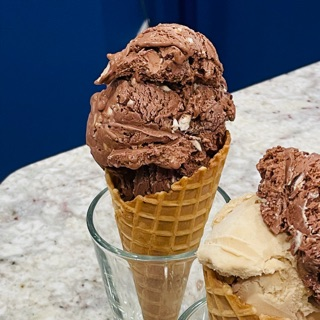

# Malted Chocolate

## Blend the base

- 240 g heavy cream
- 240 g whole milk
- 85 g egg yolk
- 150 g sugar
- 21 g Dutch cocoa powder
- 135 g malted milk powder
- 1 g salt

Blend *on high* *in a Vitamix* *for 5 minutes*.

## Add the chocolate

- 115 g dark chocolate

*Reduce the speed*, drop in the chunks of dark chocolate, then *return to high* and blend *until the mixture reaches 170°F*.

## Add the cream

- 240 g heavy cream
- 5 g vanilla

Combine into the base.

## Chill

Chill until cold.

## Churn

Churn in an ice cream maker until thick.

## Fold in the Whoppers

- 350 g crushed Whoppers

Fold the crushed Whoppers into the churned ice cream.

## Freeze

Freeze until firm.
