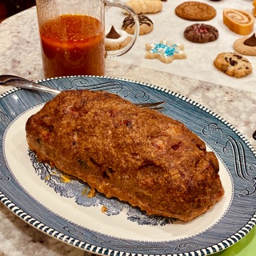

# Nana Palumbo's Meatloaf

## Meatloaf

### Mix the meatloaf

- 1 1/2 lb meatloaf mix
- 1 large egg
- 1 cup bread crumbs
- 1 medium yellow onion, finely diced
- 4 oz fresh mushrooms, diced
- 1 1/4 tsp salt
- 1/4 tsp pepper
- 4 oz tomato sauce, from 8 oz can

*Preheat oven to 350°F* with the oven rack in the middle. Combine ground meat, egg, bread crumbs, onion, mushroom, salt, pepper and 4 ounces tomato sauce in large bowl. Using your hands, break up the ground meat and work the mixture to evenly distribute all the ingredients.

### Form the loaf

Form mixture into a loaf and *place in a 2qt baking dish* with sides, such as a Pyrex 8-inch square dish.

### Bake 45 minutes

Bake the meatloaf for 45 minutes.

## Sauce mixture

### Combine the sauce

- 4 oz tomato sauce, from 8 oz can
- 1 cup water
- 2 tbsp white vinegar
- 2 tbsp yellow mustard
- 2 tbsp brown sugar

While it is baking, combine remaining tomato sauce with water, vinegar, mustard, and brown sugar. Stir well. Note that the mustard will not fully break up and will leave little yellow dots in the sauce.

## Finish

### Pour sauce over meatloaf

- [meatloaf](#meatloaf)
- [sauce mixture](#sauce-mixture)

After the first 45 minutes, carefully pour the sauce mixture over the meatloaf and return to the oven for *another 45 minutes*.

## Notes

- Meatloaf mix is a combination of ground beef, ground veal, and ground pork.  If you cannot find meatloaf mix, combine one pound of 90/10 ground beef with half-a-pound ground pork.
