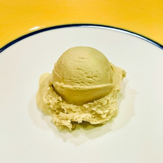

# Pistachio in the style of Van Leeuwen

## Whirl 30 seconds

- 92.5 g shelled pistachios
- 92.5 g sugar
- 2.3 g kosher salt

Whirl *in a Vitamix* *on high speed* for 30 seconds.

## Add milk

- 100 g whole milk

Add the milk and whirl *on high speed* *for 60 seconds*.

## Add remaining ingredients

- 100 g sugar
- 180 g whole milk
- 500 g heavy cream
- 115 g egg yolk

Add the remaining ingredients and whirl *on high speed* *for 6 minutes*, *to 170°F*.

## Chill base

Chill the base.

## Churn

Churn.
